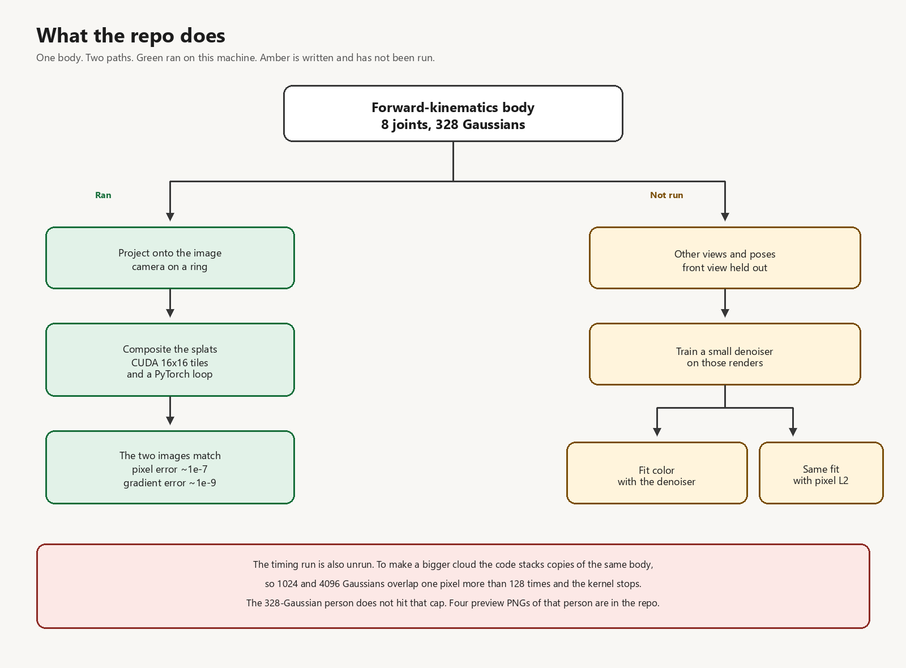

# Gaussian splatting profile

Posed body of 3D Gaussians, a pose- and view-conditioned denoiser, and a tiled rasterizer checked against a PyTorch reference.



## Layout

- `humangs_profile/body.py` — skeleton and learnable appearance
- `humangs_profile/render.py` — projection, PyTorch composite, CUDA kernel
- `humangs_profile/diffusion.py` — epsilon model and score-distillation step
- `humangs_profile/study.py` — prior, appearance fit, rasterizer timings
- `tests/test_rasterizer.py` — CUDA composite against the reference

## Run

From the repo root, with a CUDA build of PyTorch:

```
python tests/test_rasterizer.py
python -m humangs_profile.study --quick
python -m humangs_profile.study
```

The first CUDA call compiles `humangs_profile/csrc`.

A pixel stores at most 128 contributors (`MAX_CONTRIB` in `render.py`). Stacked copies past that raise an error.
